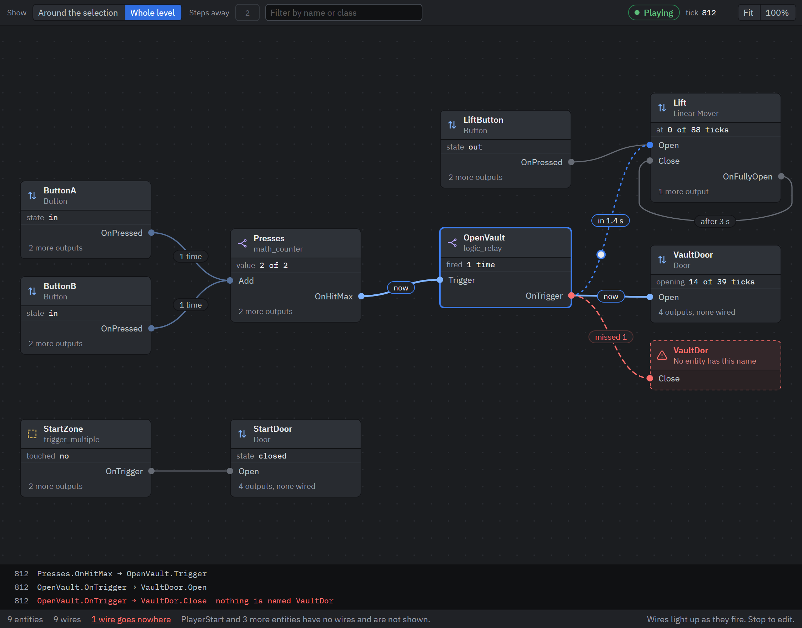
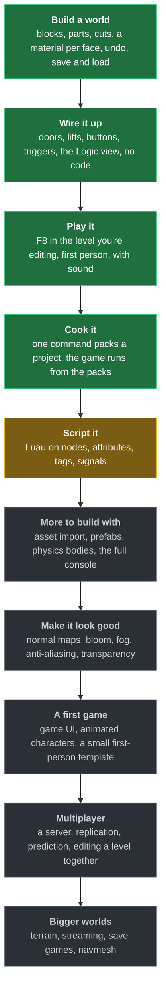

<p align="center">
  
</p>

# Spectra Engine

Spectra is a game engine and an editor for it, written in C# on .NET 10.

The short version: it's the editing experience of Roblox Studio and Hammer, in an engine where you own the game. You build the world right in the editor, wire up doors and buttons without code, and press play in the level you're working on. A project is a folder of plain files, and the game you get out of it is a normal executable that belongs to you.

I'm building it for people who make worlds. Mostly that's Roblox developers who want to leave but find Unity and Unreal too hard to get into, and Hammer mappers who want a current engine they can ship a game on. It isn't tied to a genre though. Nothing genre specific goes into the engine, so a horror game, a shooter or an RTS should all end up possible as content and scripts.



That's the Logic view while a level plays. Each card is an entity and each line is a wire, and a wire lights up when it fires. The red one points at a name nothing has.

## Where it's at

It's early. You can build a level, wire it up, script it in Luau, walk around in it and cook it into packs the game runs from. Scripting is new and still thin, so it's too soon to make a real game with it. There are no downloads either, so the way in is building from source.

| | Works today | Not yet |
|---|---|---|
| Building | Blocks that fuse into one solid world, parts that keep their own shape and can move, cuts for doorways and windows, and a material per face. The world recompiles in the background and only where you edited, so a huge world edits as fast as a small one. | Terrain |
| Editor | The engine runs inside an Avalonia shell with a ribbon, docking panels and a command palette. Move, rotate and size gizmos with snapping, box select, duplicate, group, and undo where one drag is one step. | Linux. Importing assets from inside the editor. Vertex snapping. A second viewport. |
| Logic without code | Entities like Source has them: doors, lifts, buttons, triggers, teleports, timers, counters, relays, sounds. You connect an output of one to an input of another in the Properties panel, or drag a wire in the Logic view. | Prefabs. Only the player sets off a trigger. |
| Playing | F8 plays the level you're editing in first person, and F8 again puts everything back where it was. The character walks, jumps, climbs steps, rides lifts and presses buttons. Physics is Box3D. | Bodies that fall over and get pushed around |
| Rendering | OpenGL, D3D11 and D3D12. Deferred by default with forward next to it, physically based, HDR with tone mapping. Directional, point, spot, rect and disc lights, and cascaded shadows from the sun. | Anti-aliasing, normal maps, transparent materials, bloom, fog, image-based lighting, particles, decals. Eight lights at most, and only one casts shadows. |
| Shaders | SpectraShade, the engine's own shader language. One `.spectrashade` file compiles to GLSL and HLSL and reloads when you save it. It has a command line compiler, a language server and a Visual Studio extension. | Imports, a type checker, material parameters |
| Sound | Positional sound through OpenAL with distance falloff, Doppler, and walls that muffle a sound by what they're made of and how thick they are. Captions and subtitles come from plain text files. | Sound around corners, reverb, music, compressed audio. Nothing draws the captions on screen yet. |
| Content | Everything loads from loose files or from `.spack` packs. `scook` cooks a project into packs: compressed textures, glTF models, audio, compiled shaders and baked levels. The same input gives the same bytes, on Windows and on Linux. | Cooked materials, skinned models, collision shapes on models |
| Console | One command line per engine. You reach it from the editor, from the terminal or from the demo's command line. `ent_fire`, `ent_list`, `ent_show` and `ent_watch` poke at a running level. | Variables, key binds, config files, completion |
| Scripting | Luau scripts on nodes, each one a `.luau` file in the project. They run while the level plays, on its fixed tick, and stopping puts back everything a script changed. A script finds nodes the way a Roblox script does, moves them, waits, reaches the player and requires modules. An error shows in Output with its file and line, and a click opens the file there. The editor sets the project up for VS Code and `luau-lsp`, so you get completion and type checking from the first script on. | Touch events, making and removing parts, tags and attributes, a debugger. A change to a script waits for the next Play. |

Not started at all: multiplayer, game UI, terrain and save games. Animation has skeletons, clips and pose blending on the CPU, but nothing imports or draws them.

## Build and run

You need Windows 10 or 11, the [.NET 10 SDK](https://dotnet.microsoft.com/download) and Git. Physics is native code, so you also need CMake and Visual Studio with the C++ workload to build it once.

```bash
git submodule update --init --recursive   # the Box3D source
```

```powershell
native/build-box3d.ps1                    # builds box3d.dll, only needed once
```

```bash
dotnet build
dotnet run --project SpectraEngine.Editor -- d3d11
```

The editor opens on a start page where you make or open a project. It runs on `d3d11` or `d3d12`.

There's also a demo without the editor around it, and that one takes `opengl` too:

```bash
dotnet run --project SpectraEngine.Executable -- d3d11
```

In both, hold the right mouse button to look around and fly with W, A, S and D. F8 drops you into the level as a character and F8 again brings you back.

Tests are xUnit v3 on Microsoft.Testing.Platform, so every suite is its own program. Run one with `dotnet run`, not `dotnet test`:

```bash
dotnet run --project Test/SpectraEngine.Bsp.Tests
```

The other suites sit next to it in `Test/`.

On Linux the engine, the cook and the tests build and pass in CI. The editor doesn't run there yet.

## Roadmap



<sub>Green works today. Amber is next. Grey is planned, in this order.</sub>

The first real target is a small first-person game made completely in the editor and in Luau, with no engine code. [ROADMAP.md](ROADMAP.md) has what I'm working on right now, what comes after and what I'm not going to do.

## What it's built around

- Everything is written to be AOT compiled. No reflection and no runtime codegen, so entity classes get their parsing and registration from a source generator.
- Open world from the start. There are no sealed maps, no vis compile and no map size limit. You place a block the way you place a part in Studio, wherever you want.
- Blocks are there to build quickly. The engine is still asset first: a finished game is mostly models and materials.
- A project is plain files. A level is a folder of JSON you can diff and edit outside the editor, and only the cooked game is binary.
- It has to run well on weak hardware. People with bad computers should get to play too.
- Editor code never ships in a game. The tools live in their own assemblies and a game only reads packs.

## Docs

The user docs are a Starlight site in `site/`:

```bash
npm --prefix site install
npm --prefix site run dev    # http://localhost:4321
```

Run `npm --prefix site run api` before `dev` if you also want the C# reference. A good first page is "Make a door that opens", which builds a working door with no code.

If you want to work on the engine itself, these are the ones to read:

- [docs/positioning.md](docs/positioning.md): who the engine is for and why
- [docs/data-model.md](docs/data-model.md): the scene, its nodes and what hangs off them
- [docs/formats-and-pipeline.md](docs/formats-and-pipeline.md): every file format and the cook
- [docs/code-style.md](docs/code-style.md): how code and text get written here
- [AGENTS.md](AGENTS.md): the short guide to the codebase. It's written for coding agents but it's just as useful for a person.

## What's where

```
Assets/                        the content root: textures, materials, models, sounds
SpectraEngine.Core/            the engine
SpectraEngine.Editing/         editor logic: commands, undo, gizmos, cameras
SpectraEngine.Editor/          the editor shell (Avalonia)
SpectraEngine.Executable/      the demo
SpectraEngine.Entities/        the built-in entities, with their source generator next to it
SpectraEngine.Physics.Box3D/   the Box3D binding
Spectra.Kitchen/               the cook (scook)
SpectraShade.*/                the shader compiler, its CLI, language server and VS extension
Test/                          the test suites
site/                          the user docs
docs/                          design notes
native/, external/             the Box3D build script and its source
```

## Contributing

If you want to work on this, read [docs/code-style.md](docs/code-style.md) first. Keep AOT in mind, and think things through before you reach for AI. Review AI code before you use it and test it properly.

Other than that, have fun working on this!

## License

There's no license file yet. The plan is MPL-2.0 for the engine and MIT for templates and example projects.
