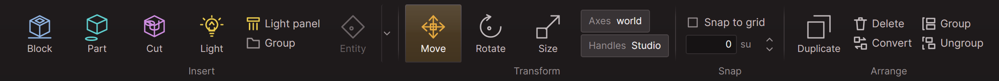

import { Steps, Tabs, TabItem } from '@astrojs/starlight/components';

Pages are Markdown files under `site/src/content/docs`. The folder path is the URL.

## Run the site

```bash
cd site
npm install
npm run api
npm run dev
```

`npm run api` builds the C# API reference and the script reference, and needs the .NET SDK. Skip it if you are only writing guides.

## Add a page

<Steps>

1. Create a `.md` file in the folder it belongs to. Use `.mdx` if the page needs components like the ones below.

2. Give it a title and a one-line description at the top:

   ```md
   ---
   title: Resize a brush
   description: Drag a face handle to change a brush's size.
   ---
   ```

3. Add it to the sidebar in `site/astro.config.mjs`.

</Steps>

## How to write

Plain words and short sentences. One task per page. Show the thing before you explain it. The "Writing" section of `docs/code-style.md` applies here too.

## Images

Put the image in `site/src/assets` and link it like any Markdown image. It is resized and compressed when the site is built.

```md

```


Nobody captured that picture by hand. The editor's render tests draw the ribbon without a window, so the image can be made again whenever the ribbon changes.

## Short clips

A clip is a few seconds long and has no sound, like a GIF. Export it as `.mp4` and keep it to a few megabytes. Put it in `site/public/clips` and use a video tag:

```html
<video src="/clips/resize-brush.mp4" autoplay loop muted playsinline></video>
```

## Longer video

Anything with sound or longer than a clip goes on YouTube and is embedded:

```html
<iframe
  src="https://www.youtube-nocookie.com/embed/VIDEO_ID"
  title="What the video shows"
  allowfullscreen
></iframe>
```

## Notes, steps and tabs

:::note
A note, for something worth knowing.
:::

:::caution
A caution, for something that loses work.
:::

<Tabs>
  <TabItem label="Keyboard">Press W to move, E to rotate, R to resize.</TabItem>
  <TabItem label="Ribbon">Pick Move, Rotate or Size on the Build tab.</TabItem>
</Tabs>

The numbered list under "Add a page" is the steps component.

## Scripts on a page

A block of Luau on a page is the whole text of a sample file under `Test/SpectraEngine.Scripting.Tests/Samples/Assets`, copied in. The scripting test suite fails for a block that is no sample, so nothing a reader copies goes unchecked: luau-lsp reads every sample under both of its type solvers, and the engine's own Luau compiles it.

<Steps>

1. Write the script as a `.luau` file under `Samples/Assets/Guides`, in a folder for the page. A script that asks for a module by a path goes under `Samples/Assets/Scripts`, where the path is the one a reader's project has.

2. A script with a mistake the page wants to show goes under `Samples/Assets/Mistakes`. End the wrong line with `-->` and the words luau-lsp has to say of it. The page shows the file without the arrow.

3. Copy the file's text into a `luau` block on the page.

4. Give the page a test class that plays the script in a level and holds what the page says it prints, and name the two in `SitePageScriptTests`.

</Steps>

`docs/script-api.md` in the repository says how the samples are checked.

## The API reference

The pages under Reference, Engine API are generated from the `///` comments in the code. Don't edit them here. Change the comment and run `npm run api` again.

The pages under Reference, Script API are generated too, from the engine's description of what a script can reach. A summary there is the `///` comment of the member that declares it. `npm run script-api` writes these pages alone.
